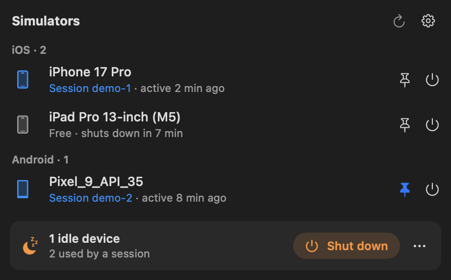

# SimLease

Share iOS simulators and Android emulators between parallel Claude Code sessions, instead of letting each session boot its own.

Run four Claude Code sessions on mobile projects and you can end up with four or more simulators running at once. A booted iOS simulator is around 200 processes and several GB of RAM, so a few of them saturate memory and slow the whole Mac down. Nothing shuts them down when a session finishes or goes idle.

SimLease has two parts:

- **`sim-lease`**, a bash script that sessions call to *lease* a device. It hands back a device the session already holds, otherwise an idle booted one, and boots a new one only while under a cap. Devices nobody is using are shut down after a grace period.
- **SimBar**, a menu bar app that shows the booted devices with the RAM and CPU of each, which session is using them, and lets you open that session, show the device, pin it or shut it down. It also runs the cleanup every 5 minutes.



## Requirements

- macOS 15 or later (the script uses the system `/usr/bin/jq`)
- Xcode (the full app, with an iOS simulator runtime), for iOS simulators
- The Android SDK, optional, for Android emulators
- [Claude Code](https://claude.com/claude-code)

## Install

**Homebrew** (recommended):

```bash
brew install --cask motystudio/tap/simlease
```

This installs `SimBar.app` (signed and notarized) and links `sim-lease` into the Homebrew `bin` directory.

**Download**: get the zip from [GitHub Releases](https://github.com/motystudio/SimLease/releases), unzip it and move `SimBar.app` to `/Applications`.

**From source**:

```bash
./build.sh                    # builds build/SimBar.app (universal, ad-hoc signed)
scripts/install-local.sh      # installs it locally, for development
```

## Getting started

Open SimBar. On first launch a setup assistant:

1. checks the requirements;
2. installs the script into `~/.claude/bin/sim-lease`;
3. adds the `<simulators>` rule to `~/.claude/CLAUDE.md`;
4. adds a `SessionEnd` hook to `~/.claude/settings.json` (a backup is saved next to it first);
5. lets you choose launch at login, automatic updates, and whether to shut down simulators you started by hand.

You can reopen it at any time from the gear menu in SimBar. From then on, new Claude Code sessions lease devices through `sim-lease` instead of booting their own.

## How it works

| Situation | What happens |
|---|---|
| A session runs `sim-lease acquire ios` | It gets the device it already holds, otherwise an idle booted device, otherwise a new one if the platform is under its cap |
| The session is active | Its device stays reserved for it. Activity is the last modification time of the session's transcript |
| The session has been idle for 20 min, or runs `sim-lease release` | The device stays booted 10 more min so another session can reuse it, then it is shut down |
| The session ends | The `SessionEnd` hook releases its devices (same 10 min grace) |
| A device was started by hand, outside sim-lease | It is left alone by default. With `SIM_LEASE_ADOPT_UNMANAGED=1`, it is shut down after 30 min unless a session leases it. A session can lease it either way, and from then on it is managed like any other |
| A device is pinned (`sim-lease pin ID`, or the pin in SimBar) | It is never shut down automatically, only by hand |
| Every device of a platform is in use | `acquire` exits with code 3; retry with `--wait 300` |

Physical devices are never touched: only simulators and emulators (`emulator-*` serials) are listed or shut down.

Leases are plain files in `~/.claude/sim-leases/`, along with a log (`sim-lease.log`).

### SimBar

- Each booted device shows its RAM and CPU and the session holding it.
- Clicking the session's name opens it in the Claude desktop app.
- Clicking the phone icon shows the device: the emulator window on Android; on iOS, Simulator.app, or DeviceHub since Xcode 27 (which cannot be told which device to show).
- The power button shuts a device down; the pin keeps it alive.
- If the menu bar icon is hidden (for example by a crowded menu bar), launching the app again opens the panel in a window.
- The interface is in English, or French when French is the system's first language.

## Configuration

Open **Settings…** from the gear menu in SimBar (⌘,), or use the CLI. Values are stored in `~/.claude/sim-lease.conf`; environment variables with the same names override the file.

| Key | Default | Meaning |
|---|---|---|
| `SIM_LEASE_MAX_IOS` | `3` | Maximum number of booted iOS simulators |
| `SIM_LEASE_MAX_ANDROID` | `2` | Maximum number of booted Android emulators |
| `SIM_LEASE_STALE_MIN` | `20` | A lease expires when its session has been idle this many minutes |
| `SIM_LEASE_GRACE_MIN` | `10` | A released device stays booted this many minutes for reuse, then is shut down |
| `SIM_LEASE_ADOPT_UNMANAGED` | `0` | `1` = also shut down devices started by hand, outside sim-lease |
| `SIM_LEASE_UNMANAGED_GRACE_MIN` | `30` | With adoption on, minutes before an unleased hand-started device is shut down |

```bash
sim-lease config                          # show the current values
sim-lease config set SIM_LEASE_MAX_IOS 2  # change one
sim-lease config reset SIM_LEASE_MAX_IOS  # back to its default
sim-lease config reset                    # every key back to its default
```

## Commands

```
sim-lease acquire ios|android [--name NAME] [--wait SECS]   print the UDID / adb serial of a leased device
sim-lease release [ID]               release this session's lease(s); the device stays warm for reuse
sim-lease release-session [SID]      release every lease of a session (used by the SessionEnd hook)
sim-lease status                     booted devices and who holds them
sim-lease json                       the same, as JSON (used by SimBar)
sim-lease pin|unpin ID               keep a device alive / let it be shut down again
sim-lease kill ID                    shut a device down now, whoever holds it
sim-lease shutdown-idle              shut down every booted device without an active lease, now
sim-lease reap                       run the cleanup once (SimBar does this every 5 min)
sim-lease config [json]              show the configuration
sim-lease config set KEY VALUE       change a setting
sim-lease config reset [KEY]         reset one setting, or all of them
sim-lease version                    print the version
sim-lease help                       print this list
```

`acquire` must run inside a Claude Code session: it identifies the session with `CLAUDE_CODE_SESSION_ID`. `--name` takes a simulator name or UDID on iOS, an AVD name on Android. Exit code 3 means every device of that platform is in use.

## Teaching Claude Code to use it

The script only helps if sessions call it. The setup assistant installs two things for that:

- **The `<simulators>` rule** in `~/.claude/CLAUDE.md` tells every session never to boot a simulator or emulator itself, to get one with `sim-lease acquire`, to use only that device ID, and to run `sim-lease release` when done. The text is in [CLAUDE.snippet.md](CLAUDE.snippet.md); you can paste it yourself instead. SimBar adds a `<!-- simbar-rule … -->` line inside the block so it can tell its own text from yours: a block you edited is never replaced without asking.
- **The `SessionEnd` hook** in `~/.claude/settings.json` releases a session's devices when it ends, for sessions that forget. To add it by hand, append this entry to `hooks.SessionEnd`:

  ```json
  { "hooks": [{ "type": "command", "command": "\"$HOME/.claude/bin/sim-lease\" release-session", "timeout": 30 }] }
  ```

Both files are followed through symlinks, so dotfiles setups keep working, and SimBar saves the previous version next to them (`CLAUDE.md.backup-simbar`, `settings.json.backup-simbar`) whenever it changes one.

Even without the hook, a device is freed once its session has been idle for `SIM_LEASE_STALE_MIN` minutes.

## Uninstall

With Homebrew:

```bash
brew uninstall --zap --cask simlease
```

Then remove `~/.claude/bin/sim-lease`, the `<simulators>` block from `~/.claude/CLAUDE.md` and the `sim-lease release-session` entry from `hooks.SessionEnd` in `~/.claude/settings.json`, if they are still there. Homebrew can't edit those files for you, and the script stays until you remove the hook that calls it.

By hand, remove:

- `SimBar.app`
- `~/.claude/bin/sim-lease`
- `~/.claude/sim-leases/` (leases, pins and log)
- `~/.claude/sim-lease.conf`
- the `<simulators>` … `</simulators>` block in `~/.claude/CLAUDE.md` (and `CLAUDE.md.backup-simbar` if you don't need it)
- the `sim-lease release-session` entry under `hooks.SessionEnd` in `~/.claude/settings.json` (and `settings.json.backup-simbar` if you don't need it)

## Limitations

- **It relies on Claude Code internals that are not a public API**, so a Claude Code update can break it:
  - the `CLAUDE_CODE_SESSION_ID` and `CLAUDE_CODE_HOST_SESSION_ID` environment variables, to know which session is calling;
  - the transcript files under `~/.claude/projects/`, whose modification time is used as the session's activity signal;
  - the `claude://` deep link and the Claude desktop app's session folder (`~/Library/Application Support/Claude/claude-code-sessions`), used to show session names and open them. Opening a session therefore works for sessions run in the Claude desktop app.
- It only works if sessions follow the rule. A session that boots a device itself bypasses the cap; with `SIM_LEASE_ADOPT_UNMANAGED=0` such a device is left alone until a session leases it.
- Physical devices are never touched.
- macOS only.

## Development

```bash
./build.sh                    # build/SimBar.app, universal, ad-hoc signed
scripts/install-local.sh      # install the build locally
```

The app bundles its own copies of `bin/sim-lease` and `CLAUDE.snippet.md`, which the setup assistant installs into `~/.claude`.

Debug flags:

- `SimBar --setup DIR` runs the installation check and install against `DIR`, a stand-in for `~/.claude`, then exits. Add `--replace-rule` to also replace a customized or malformed `<simulators>` block, as the confirmation dialog does.
- `build/SimBar.app/Contents/MacOS/SimBar --snapshot out.png` renders the panel with live data to a PNG and exits. Add `--view settings` or `--view onboarding-1` … `onboarding-5` to render another window, `--sim-lease PATH` to use another script, and `--claude-dir DIR` to check a stand-in for `~/.claude`.

Releases are cut with `scripts/release.sh`: it builds the app, signs it with a Developer ID, notarizes it, and publishes the zip that GitHub Releases, Sparkle updates and the Homebrew cask all point to. The script documents its steps and the credentials it expects.

See [CONTRIBUTING.md](CONTRIBUTING.md) and [CHANGELOG.md](CHANGELOG.md).

## License

MIT, see [LICENSE](LICENSE).
